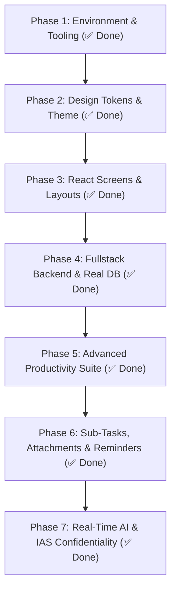

# Taskora — Comprehensive Project Blueprint, Completed Milestones & Implementation Roadmap

> **Date:** November 2026  
> **Application:** Taskora — Modern Fullstack To-Do & Task Management Platform  
> **Tech Stack:** Laravel 13 (PHP 8.3) + Inertia.js + React 18 (TypeScript) + Tailwind CSS + MySQL 8.4  
> **Security Standard:** Strict CIA Triad (Confidentiality, Integrity, Availability)  
> **Timezone:** Asia/Manila (UTC+8)  
> **GitHub Repository:** [`Freakshowzzz/taskora`](https://github.com/Freakshowzzz/taskora.git)  
> **Workspace Directory:** `C:\laragon\www\taskora`  

---

## 1. Executive Summary & Current Status

Taskora is a production-ready, fullstack task management application engineered with a clean monorepo architecture combining the power of Laravel 13 on the backend with React 18 & TypeScript via Inertia.js on the frontend.

All foundational milestones (Database schema, Eloquent relationships, CIA security policies, RESTful endpoints, UI design tokens, real-time dashboard analytics, task CRUD, separate date/time pickers, and dynamic weekly sprint tracking) are **100% completed, tested, and pushed to GitHub**.



---

## 2. Core Architecture & Design Standards

### A. Monolithic Fullstack Architecture (Inertia.js)
- **Zero Decoupled Overhead:** No CORS preflight issues, token refresh vulnerabilities, or redundant API contracts.
- **Backend Authority:** Laravel handles session authentication, database transactions, validation, and authorization policies.
- **Frontend Interactivity:** React 18 + TypeScript delivers a seamless Single Page App (SPA) experience with instant client-side transitions and zero page reloads.

### B. Taskora Brand & UI/UX System
- **Primary Color:** Deep Indigo (`#3525cd`) with soft Indigo container tint (`#4f46e5`).
- **Canvas & Surfaces:** Crisp slate canvas (`#F8FAFC`) with pure white elevated cards (`#FFFFFF`).
- **Typography & Icons:** Google Inter typography (weights 400 to 700) and Google Material Symbols Outlined.
- **Copyright Integrity:** Uniformly rendered as `© 2026 Taskora Inc. All rights reserved.` across all pages.
- **Brand Navigation:** The Taskora logo in all headers and sidebars links directly back to the Home/Dashboard (`/dashboard`).

### C. Strict CIA Triad Security Model
- **Confidentiality:** All Eloquent queries are scoped strictly to the authenticated user (`auth()->user()->tasks()`). No user can ever view, query, or enumerate another user's tasks.
- **Integrity:** Strict form request validation, CSRF middleware protection, and Laravel Policies (`TaskPolicy`) preventing unauthorized modifications.
- **Availability:** Database composite indexes on `(user_id, completed_at, due_at)`, rate-limited endpoints, and robust error handling.

---

## 3. What Has Been Completed & Verified (Milestones 1–4)

### ✅ Phase 1: Environment & Tooling
- [x] Laragon local server configured (PHP 8.3.36, Composer 2.10.3, MySQL 8.4.3).
- [x] Laravel 12 scaffolded with Laravel Breeze (Inertia + React + TypeScript).
- [x] MySQL database `taskora` connected and migrated.
- [x] Fixed Vite 8 and React plugin peer dependencies (`--legacy-peer-deps`).
- [x] Configured `resources/js/bootstrap.ts` for Inertia/Axios initialization.

### ✅ Phase 2: Design Tokens & Styling
- [x] `tailwind.config.js` customized with Taskora palette (`primary`, `primary-container`, `badge` tokens).
- [x] Google Fonts (`Inter`) and Material Symbols Outlined loaded in `resources/views/app.blade.php`.
- [x] Custom CSS utilities (`.fill-1`, `.card-shadow`) in `resources/css/app.css`.

### ✅ Phase 3: Frontend Screens Built
- [x] **Login Screen (`Login.tsx`):** 2-column split showcase layout, password visibility toggle, remember me, and authentication error handling.
- [x] **Registration Screen (`Register.tsx`):** 4-bar dynamic password strength meter and confirm-password verification.
- [x] **Forgot Password Screen (`ForgotPassword.tsx`):** Recovery form with email input, blind security notice, and back to login link.
- [x] **Reset Password Screen (`ResetPassword.tsx`):** Token-based password reset form with password strength validation.
- [x] **Email Verification Screen (`VerifyEmail.tsx`):** Verification prompt screen with "Resend Verification Email" trigger and logout.
- [x] **Confirm Password Screen (`ConfirmPassword.tsx`):** Security challenge screen for protecting sensitive profile actions.
- [x] **App Shell (`AuthenticatedLayout.tsx`):** Collapsible sidebar, logo home link, search bar, user menu, global `+ Add Task` modal, and footer.
- [x] **Dashboard View (`Dashboard.tsx`):** Metric cards with circular progress gauge, pending task agenda, dynamic weekly focus sprint chart, and productivity tip.
- [x] **Tasks Management View (`Tasks/Index.tsx`):** Task creation card, filter tabs (All / Pending / Completed), multi-sort dropdown, checklist items, and badges.

### ✅ Phase 4: Fullstack Backend & Real MySQL State
- [x] **Tasks Migration:** `tasks` table with foreign key to `users` (cascade on delete), `title`, `description`, `category`, `priority` enum, `due_at`, `completed_at`, and indexing.
- [x] **Task Model & Relationships:** `App\Models\Task` with `$fillable`, datetime casts, and `user()` BelongsTo; updated `App\Models\User` with `tasks()` HasMany.
- [x] **TaskPolicy (CIA):** Strict ownership policy (`$user->id === $task->user_id`).
- [x] **TaskController:** RESTful endpoints for listing, creating, updating, toggling, and deleting tasks.
- [x] **Separate Date & Time Pickers:** Replaced combined `datetime-local` input with dedicated `<input type="date">` and `<input type="time">` pickers in both the quick bar and global modal.
- [x] **Title & Main Content Separation:** Distinct task title input and multiline textarea for description/notes with native `Shift + Enter` newline support.
- [x] **Preserved Multi-Line Display:** Task rows render descriptions using `whitespace-pre-wrap` so formatted notes and checklists display properly.
- [x] **Dynamic Weekly Focus Sprint Tracker:** Replaced static mock values with live queries of tasks completed per day (Mon–Fri) for the current calendar week. Displays accurate `• No Progress` state when empty, highlights today's active day, and tracks `completed/goal`.
- [x] **Timezone Synchronization (`Asia/Manila`, UTC+8):** Configured in `.env` and `config/app.php` so midnight day-rollovers happen at 12:00 AM local time.
- [x] **Task Completion Confirmation Modal:** Prevents accidental checkbox clicks with a confirm dialog before marking tasks complete or reopening them.
- [x] **Profile & Settings Restyling:** Polished `Profile/Edit.tsx` and created `Settings/Index.tsx` with user task defaults.
- [x] **Automated Test Suite:** 27 automated unit and feature tests passing with 91 assertions.

---

## 4. Implementation Roadmap (Phases 5–7)

### ✅ Phase 5: Advanced Productivity & Organization (Completed)
- [x] **Task Detail Slide-Over / Edit Modal:** Full edit screen to update task title, description, category, priority, separate date/time, and status toggle after creation.
- [x] **Live Search & Deep Filter Bar:** Real-time search across title and description with quick-clear button.
- [x] **Dynamic Category Filter Pills:** Dynamic category chips derived from active user tasks with instant multi-category switching.
- [x] **Priority Filter Dropdown:** Filter instantly between All Priorities, High, Medium, and Low.
- [x] **Bulk Task Actions (Multi-Select):** Master select-all checkbox, floating action bar for bulk completion, bulk reopening, and bulk deletion with modal confirmation.
- [x] **Expanded Automated Test Suite:** 36 automated unit and feature tests passing with 165 assertions.

### ✅ Phase 6: Sub-Tasks, Attachments & Due Date Reminders (Completed)
- [x] **Sub-Task Checklists:** Break tasks into checklist steps with dedicated completion toggles, progress bars, and instant inline addition/deletion.
- [x] **Attachment Uploads:** File attachment support with Laravel Storage (local disk), upload validation (up to 10MB), secure download streaming, and cascade deletion.
- [x] **Due Date Warning Badges & Reminders:** Color-coded status badges for "Overdue" (red), "Due Today" (amber), and scheduled deadlines across Tasks list and Dashboard.
- [x] **Expanded Test Suite:** 50 automated tests with 192 assertions verifying sub-task and attachment ownership, CRUD, and cascade deletion under the CIA Triad.

### 🤖 Phase 7: AI Integration & External Services (Completed)
- [x] **Real-Time Streaming AI Assistant (SSE):** Token-by-token streaming responses via Server-Sent Events (`POST /ai/stream`) with typewriter effect, live cursor, and abort support. Powered by Google Gemini 3.5 Flash Lite or seamless local intelligence fallback.
- [x] **IAS Confidentiality Guardrail (Strict CIA Triad):** Dual-layer pre-inference guardrail and system-level isolation strictly preventing leakage of database schemas, credentials, table structures, system internals, `.env` files, or other users' data. The AI answers only what the authenticated user needs assistance with (personal task planning, prioritization, 5-step checklist generation, and Taskora features).
- [x] **1-Click "+ Add to My Tasks":** Actionable checklists generated by the AI can be added to the user's task list in a single click via `POST /ai/quick-create`.
- [x] **Help & Support Placement:** Accessible strictly via the **Ask Kora** button in the sidebar above Sign Out.
- [x] **Expanded Automated Test Suite:** 76 automated unit and feature tests passing with 345 assertions under strict CIA Triad user isolation, complete file lifecycle garbage collection, and code-quality hardening.
- [x] **User Profile Picture & Avatar Customization:** Allow authenticated users to upload, preview, and update a personal profile picture (JPEG, PNG, WebP up to 2MB) in Account Settings with secure local storage (`storage/app/public/avatars`), strict image validation, and dynamic fallback to user initials in the top header and sidebar.
- [x] **Live Mail Transport (SMTP / Resend API):** Full live mail transport integration with TLS/SSL encryption support in `config/mail.php`, responsive HTML branded notification template (`system-notification.blade.php`), Mailable class (`TaskoraSystemNotification`), automated tests (`MailTransportTest`), and interactive diagnostic CLI tool (`php artisan mail:test {email?}`). Delivered to real recipient inboxes or local log transport seamlessly.

---

## 5. How to Run the Application

Open two terminal sessions:

### Terminal 1 — Laravel Backend:
```cmd
set PATH=C:\laragon\bin\php\php-8.3.36-Win32-vs16-x64;%PATH%
cd C:\laragon\www\taskora
php artisan serve
```
*(Or click the **Terminal** button in Laragon and run `php artisan serve`)*

### Terminal 2 — Frontend Compiler:
```cmd
cd C:\laragon\www\taskora
npm run dev
```

### Access URLs:
- **Login:** [http://localhost:8000/login](http://localhost:8000/login)
- **Register:** [http://localhost:8000/register](http://localhost:8000/register)
- **Dashboard:** [http://localhost:8000/dashboard](http://localhost:8000/dashboard)
- **My Tasks:** [http://localhost:8000/tasks](http://localhost:8000/tasks)
- **Settings:** [http://localhost:8000/settings](http://localhost:8000/settings)

### Production Deployment ($0.00 Free Tier):
- For permanent cloud deployment instructions using Render & Aiven MySQL, inspect [FREE_DEPLOYMENT_GUIDE.md](FREE_DEPLOYMENT_GUIDE.md).

---

## 6. Crucial Diskless PC Safety Warning ⚠️

> [!WARNING]
> Because this is a **diskless computer shop PC**, everything on drive `C:\` resides in temporary RAM. **If the computer restarts or the shop session ends, local files will be wiped!**

### How to Save Your Work in 60 Seconds:
1. Open Windows File Explorer (`Win + E`) and navigate to `C:\laragon\www`.
2. Right-click the **`taskora`** folder $\rightarrow$ **Send to** $\rightarrow$ **Compressed (zipped) folder**.
3. Upload `taskora.zip` to your **Google Drive** or copy it to a **USB drive**.
4. All code is also backed up on your private GitHub repository: [`https://github.com/Freakshowzzz/taskora.git`](https://github.com/Freakshowzzz/taskora.git).
